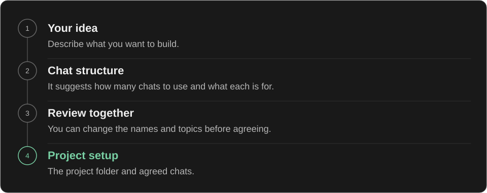
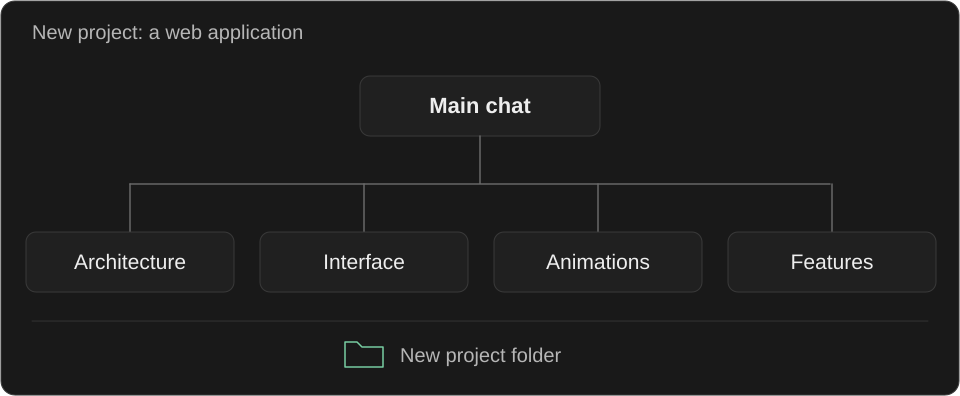

<p align="center">
  
</p>

# Thread Maestro

**English** · [Русский](README.ru.md)

When starting a project, users often forget to create separate chats for different tasks. All the work ends up in one conversation, mixing requirements, decisions, and discussions. As irrelevant context builds up, the quality of AI responses can deteriorate.

Thread Maestro handles this organization: it creates chats tailored to the project's tasks after approval. This makes the project easier to navigate, while separating context helps save tokens and maintain the quality of AI responses.

## Starting a project

Describe the new project you want to build. Codex can select Thread Maestro automatically, recommend 3, 5, or 7 chats, and show them as cards: the main chat above a grid of the others. Each card has an icon, a title, and a short purpose. If that format is unavailable, it uses a plain table.

You can choose another of these three layouts. The skill updates the cards, then helps set up the project after approval. Seven is the largest layout supported by this skill.

The setup view offers a suggested folder or a path of your own. If the folder needs to be added to Codex, it shows that as your next step. The same card lists the files, chats, and first-reply behavior. Select "Confirm and create" when ready; Codex verifies the project and starts the agreed setup without asking you to approve it again.

Repeated requests keep the results already confirmed. If setup is interrupted, the skill checks what was created and continues with the missing chats. An older card cannot approve a newer plan.



Then use them like ordinary Codex chats: open one and give it a task.

If a question clearly belongs in another chat, the current chat will point it out. You can still continue in the current chat if you prefer.

## Example of a new project



Suppose you want to build a web application. The skill might suggest this structure. The number of chats and their roles depend on the idea.

## Installation

Download the repository and copy the entire [`skills/thread-maestro`](skills/thread-maestro) folder to one of these locations:

| Where to use it | Folder |
| --- | --- |
| All projects | `~/.agents/skills/thread-maestro/` |
| One project | `<project>/.agents/skills/thread-maestro/` |

The `~` symbol means your user home folder. If the skill does not appear, restart Codex. See the [Codex documentation](https://learn.chatgpt.com/docs/build-skills) for more installation details.

## Usage

Describe your new project in a chat. Automatic selection is enabled, so you do not have to name the skill. To select it explicitly, enter:

```text
$thread-maestro
```

If you have already described your idea in the conversation, the skill uses that context. Automatic selection depends on how well the request matches the skill; an explicit invocation remains available. Both modes propose the plan before creating anything.

## Existing projects

The skill can also help organize chats for an existing project. It checks which chats are already there, suggests a structure, and creates any missing chats after you approve it.

## What is inside

The skill uses the [Codex skill format](https://learn.chatgpt.com/docs/build-skills). The main instructions are in [`SKILL.md`](skills/thread-maestro/SKILL.md), alongside invocation settings, message templates, and guidance for working with the app's tools.

The instructions are written in English. Codex is instructed to respond in the user's language.

> Automatic chat creation depends on the tools available in Codex. If a required tool is missing, the skill prepares a structure and starting texts for manual setup.

## License

[MIT](LICENSE). Copyright 2026 AKDworks.
