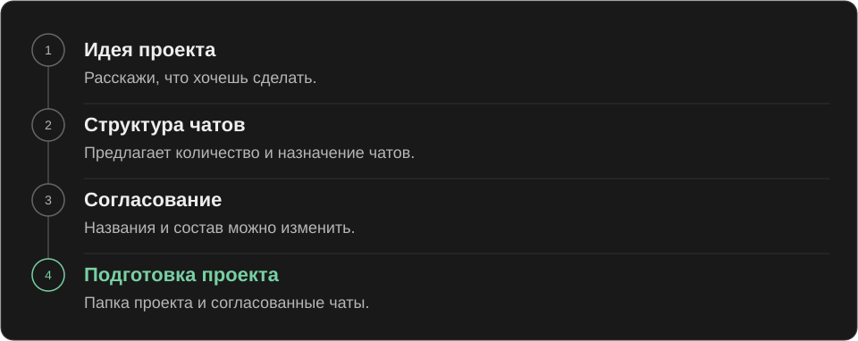
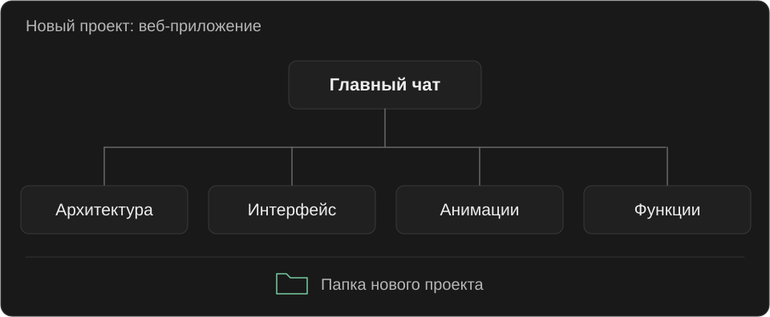

<p align="center">
  
</p>

# Thread Maestro

[English](README.md) · **Русский**

В начале проекта пользователи часто забывают создать отдельные чаты под разные задачи. В итоге вся работа остаётся в одной переписке, где смешиваются требования, решения и обсуждения. По мере накопления лишнего контекста качество ответов ИИ может деградировать.

Thread Maestro берёт эту организацию на себя: создаёт чаты под задачи проекта после согласования. Благодаря этому пользователю проще ориентироваться в проекте, а разделение контекста помогает экономить токены и сохранять качество ответов ИИ.

## Начало проекта

Расскажи, какой новый проект хочешь создать. Codex может сам подключить Thread Maestro, предложить 3, 5 или 7 чатов и показать их карточками: главный сверху, остальные сеткой ниже. В каждой карточке будут иконка, название и короткое назначение. Если такой формат недоступен, появится обычная таблица.

Можно выбрать другой вариант из этих трёх. Скилл обновит карточки, а после согласования поможет подготовить проект. В этом скилле максимум семь чатов.

В плане настройки можно оставить предложенную папку или указать свою. Если её нужно добавить в Codex, это будет показано отдельным шагом. В этой же карточке перечислены файлы, чаты и поведение первого ответа. Когда всё готово, нажми «Подтвердить и создать»: Codex проверит проект и начнёт согласованную настройку без повторного согласования.

Повторный запрос сохраняет уже подтверждённые результаты. Если настройка прервалась, скилл проверит созданные чаты и продолжит с недостающих. Старая карточка не подтверждает новый план.



Дальше ими можно пользоваться как обычными чатами Codex: открыть нужный и написать задание.

Если вопрос явно относится к другому чату, текущий чат напомнит об этом. При желании разговор можно продолжить на месте.

## Пример нового проекта



Допустим, ты решил сделать веб-приложение. Скилл может предложить такую структуру. Количество чатов и их роли зависят от задумки.

## Установка

Скачай репозиторий и скопируй папку [`skills/thread-maestro`](skills/thread-maestro) целиком в одно из этих мест:

| Где использовать | Папка |
| --- | --- |
| Во всех проектах | `~/.agents/skills/thread-maestro/` |
| В одном проекте | `<проект>/.agents/skills/thread-maestro/` |

Знак `~` обозначает домашнюю папку пользователя. Если скилл не появился, перезапусти Codex. Подробнее об установке можно прочитать в [документации Codex](https://learn.chatgpt.com/docs/build-skills).

## Использование

Опиши новый проект в чате. Автоматический выбор включён, поэтому имя скилла указывать необязательно. Для явного вызова напиши:

```text
$thread-maestro
```

Если описание идеи уже есть в разговоре, скилл использует его. Автоматический выбор зависит от совпадения запроса с назначением скилла; явный вызов тоже остаётся доступен. В обоих случаях сначала идёт предложение плана, затем создание после согласования.

## Если проект уже есть

Скилл также может помочь с организацией чатов существующего проекта. Он проверит, какие чаты уже есть, предложит подходящую структуру и создаст недостающие после согласования.

## Что внутри

Скилл написан в [формате скиллов Codex](https://learn.chatgpt.com/docs/build-skills). Основные инструкции находятся в [`SKILL.md`](skills/thread-maestro/SKILL.md). Рядом лежат настройки вызова, шаблоны сообщений и описание работы с инструментами приложения.

Инструкции написаны на английском. Язык общения выбирается по языку пользователя.

> Автоматическое создание чатов зависит от инструментов, доступных в Codex. Если нужного инструмента нет, скилл подготовит структуру и тексты для ручного создания.

## Лицензия

[MIT](LICENSE). Автор: AKDworks, 2026.
